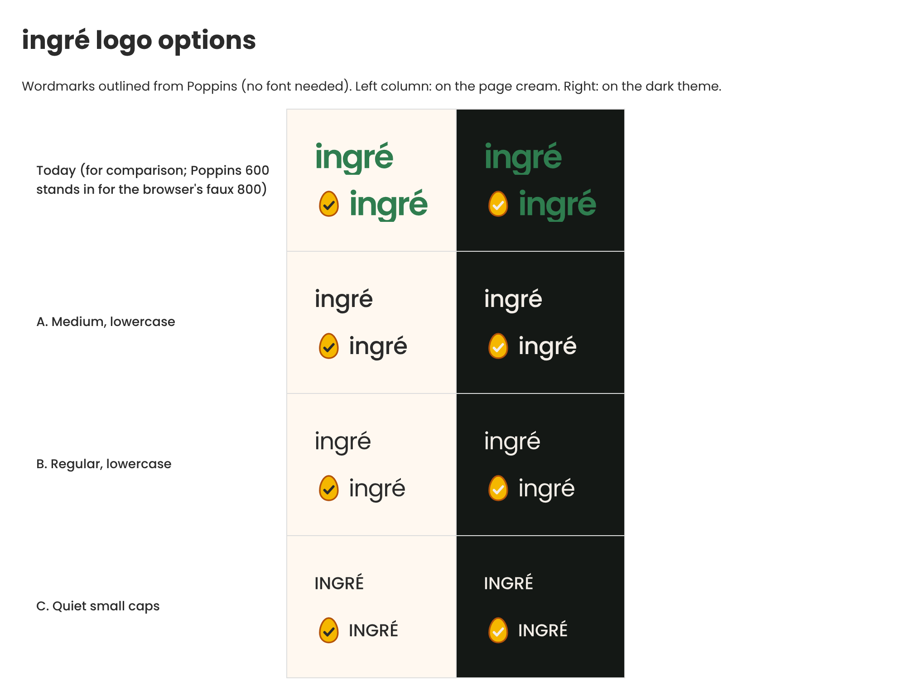

# ingré logo options (#235)

Draft assets for the owner to pick from. **Nothing in the app changes in this PR**: the header still shows today's mark. Once one is chosen, adopting it is a small follow-up (see "Adopting one").

The brief (#235): subtle luxury, one-Michelin-star feel; slightly smaller; modestly tighter letter-spacing; regular or medium weight; lowercase or quiet small caps; no decoration; near-black or the existing ink.

Open `preview.html` to see them with real SVGs. Every file is a self-contained SVG with the lettering **outlined from Poppins** (the app's font), so none needs a font installed. They have a transparent background.

| Option | Lettering | Size | Weight | Letter-spacing | Ink |
| --- | --- | --- | --- | --- | --- |
| Today (comparison only) | `ingré` | 36px | extra-bold (a synthesised bold: only Poppins 400 is loaded) | -0.05em | brand green `#2f7d4f` |
| **A. Medium** | `ingré` | 26px | 500 | -0.02em | `#2b2b2b` / dark `#f2ede7` |
| **B. Regular** | `ingré` | 26px | 400 | -0.03em | `#2b2b2b` / dark `#f2ede7` |
| **C. Quiet small caps** | `INGRÉ` | 19px | 500 | 0 | `#2b2b2b` / dark `#f2ede7` |

The "Today" row stands in Poppins 600 for the browser's faux 800, so it reads slightly lighter than the live header.

## Files

For each of `a-medium`, `b-regular`, `c-caps` (and `current` for comparison), in `light` and `dark`:

- `<option>-wordmark-<light|dark>.svg`: the lettering alone.
- `<option>-lockup-<light|dark>.svg`: the egg icon (as in `client/public/images/ingre-icon.svg`, its tick in the same ink) beside the lettering.

Ink contrast (WCAG 2.x): `#2b2b2b` on the page `#fff8f0` is 13.4:1, and `#f2ede7` on the dark page `#141815` is 15.4:1. Today's green `#2f7d4f` on cream is 4.8:1.

## How they were made

Each lettering is the glyph outlines of `@fontsource/poppins` (latin subset, weight 400 or 500) laid out with the tracking above. Pair kerning is not applied, which at these sizes is not visible. The generator is a short fontTools script; ask and it will be attached, or regenerate by changing the table above.

## Adopting one

A follow-up PR would change `client/src/components/Header.tsx` only (the `Logo` wordmark span): size (`text-2xl`), weight (`font-medium` for A, with `@fontsource/poppins/500.css` imported in `src/index.tsx`, so the weight is real rather than synthesised), tracking (`tracking-tight` is -0.025em) and ink (`text-text` instead of `text-brand`), plus the header test. For B nothing new is imported. C also needs `uppercase`.

## Questions for the owner

1. Which option: A, B or C?
2. Keep the egg beside the lettering (lockup) or the lettering alone?
3. "Modestly tighter" is read as tighter than normal text. Today's is already -0.05em, so every option here is slightly *looser* than today's but tighter than the default. Is that what you meant?
